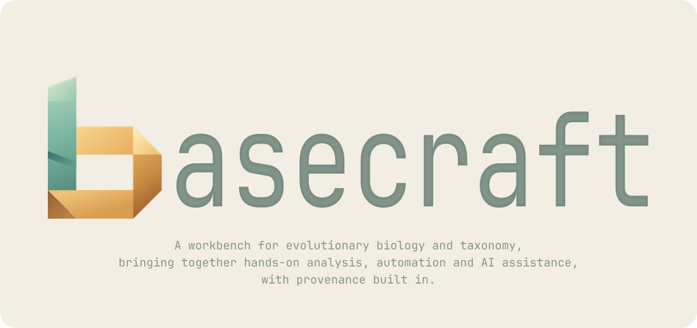

  <picture>
    <source media="(prefers-color-scheme: dark)" srcset="crates/basecraft-gui/branding/logo-dark.svg">
    <source media="(prefers-color-scheme: light)" srcset="crates/basecraft-gui/branding/logo-light.svg">
    
  </picture>

Basecraft is a desktop molecular biology workbench with a shared Rust core,
Qt/QML interface, command-line tools, Python SDK and MCP server.

- Edit and align molecular sequences, with gene and feature annotations.
- Build, explore and annotate phylogenetic trees.
- Compare species-delimitation hypotheses alongside their supporting data.
- Review Sanger chromatograms and export reviewed consensus sequences.
- Retain analysis inputs, settings and history alongside standard data formats.
- Use interactive, scripted or MCP-connected workflows through the same core.

See [guide/scripting.md](guide/scripting.md) for the CLI and Python scripting
reference and [guide/mcp.md](guide/mcp.md) for connecting an assistant.

Basecraft is development software. Platform packaging and biological validation
of the Sanger review workflow are still in progress.

The application is licensed under [GPL-3.0-or-later](LICENSE-GPL). The public
plugin protocol and Python SDK use [Apache-2.0](LICENSE-APACHE).
