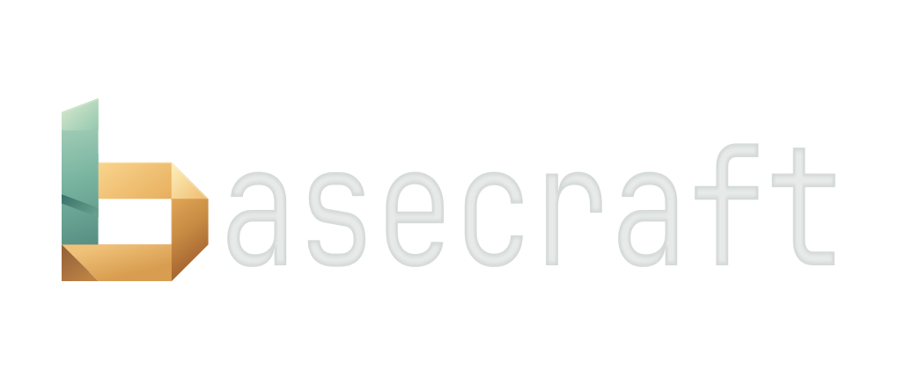
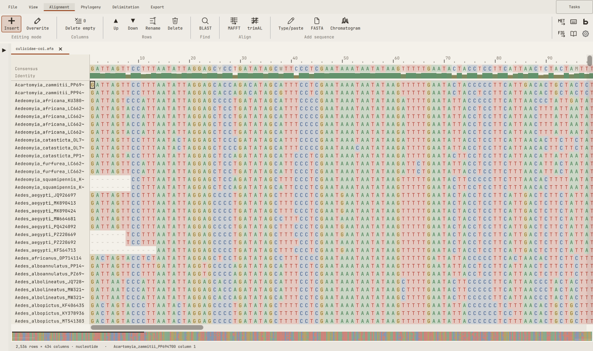
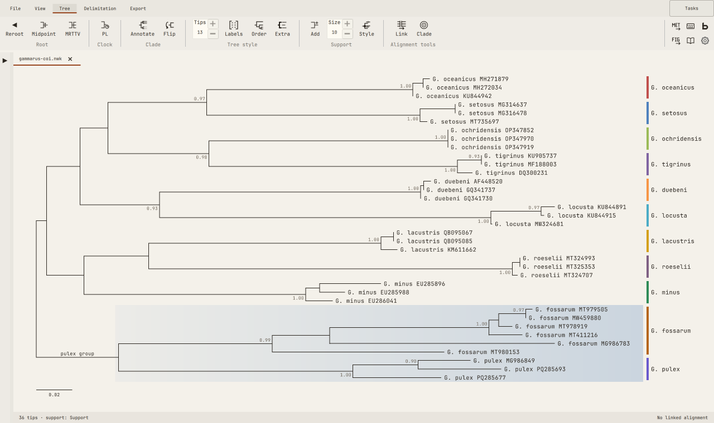

<picture>
  <source media="(prefers-color-scheme: dark)" srcset="crates/basecraft-gui/branding/wordmark-dark.svg">
  <source media="(prefers-color-scheme: light)" srcset="crates/basecraft-gui/branding/wordmark-light.svg">
  
</picture>

**A fast desktop workbench for evolutionary biology and taxonomy.**\
**Work by hand, automate it or bring in an AI assistant, with a record of each step kept automatically.**

[Install](#install) · [What you can do](#what-you-can-do) · [Speed](#speed-and-gappy-data) · [Tour](#five-minute-tour) · [Automate](#automate-it) · [Developers](#for-developers)

| Edit and align sequences | Annotate trees with clade labels, support values and species groups |
|---|---|
| <picture><source media="(prefers-color-scheme: dark)" srcset="assets/readme/hero-alignment-dark.svg"></picture> | <picture><source media="(prefers-color-scheme: dark)" srcset="assets/readme/hero-tree-dark.svg"></picture> |

## Status

Basecraft is early development software, and there is no release yet. We
develop and test it on Linux. At the moment, most features are ready, and the key
functionality for implemented algorithms has been verified against previous
implementations. Until we have a first release, we suggest you hold off using
basecraft for publication work, or at least check any result you plan to
publish against an established tool. The GUI is functional but still has rough
edges and suboptimal layout in some parts. We encourage you to try it and give
us feedback on your experience, as it's difficult to have human eyes on
all possible ways to use the GUI.

## Install

Installers aren't available yet. We have internal nightly builds for all three operating systems, so as soon as we're ready to release, you'll get them here. Meanwhile, if you are comfortable with a terminal, you can 
[build from source](#for-developers) on Linux today.

## What you can do

Start from annotated genomes, existing sequences or Sanger traces, then work
through alignment, trees and species hypotheses to figures and a GenBank
submission. You can also
join at any step with your own files.

- **Edit, align and annotate sequences.** Open FASTA and GenBank files and undo
  any edit. Align with MAFFT, trim with trimAl, find genes, and send off a sequence to NCBI BLAST in your browser.
- **Build and annotate trees.** Build trees with neighbour joining, UPGMA,
  FastTree or IQ-TREE. Reroot them, label clades and show support values. A
  tree stays linked to its alignment, and you can create a new alignment of just the selected clade with ease.
- **Compare species hypotheses.** Run GMYC, ASAP or PTP, or group specimens by
  hand, then see the hypotheses side by side next to your tree. Combine them
  into a single SPART file.
- **Review Sanger traces.** Open AB1 chromatograms, build a consensus from up to
  three reads and review the uncertain positions. Export the result as FASTA or
  add it to an alignment.
- **Prepare GenBank submissions.** Choose your records, fill in their details,
  check them with NCBI's table2asn and export the files to submit. This
  currently only runs on Linux.
- **Export beautiful figures.** Save as SVG if you want to finish it in a vector
  editor, or use the PNG export function.

## What's planned

Before the
first release, we plan to add:

- **Installers for Linux, Windows and macOS,** so you won't need a terminal to
  get started.
- **Review annotated genomes.** Check and correct what annotation tools produced
  for organelle genomes and other large sequences from high-throughput
  sequencing.
- **ENA submissions for plastid genomes,** next to the GenBank workflow.
- **Reference-assisted Sanger calling.** Base calls checked against a reference
  alignment, tested on real traces before we rely on it.
- **Checks for questionable sequences.** Spot likely chimeras, contaminants,
  pseudogenes and misaligned stretches before they end up in your tree or your
  species hypotheses.

After the first release, we plan to work on:

- **Genes across genomes.** Pull the same genes out of many annotated genomes,
  align them and build trees, up to genome-wide phylogenetics.
- **More genome annotation.** Annotate organelle genomes and other large
  sequences in basecraft, beyond checking what other tools produced.
- **Proteins and codons.** Translate with the right genetic code, switch between
  DNA and protein views, and align coding sequences codon by codon.
- **Selection.** Molecular evolution analyses such as dN/dS.
- **A new species delimitation method,** inspired by GMYC, that works directly
  on your tree's branch lengths and tells you how well supported each species is.
- **Dating with calibrations.** Set ages on nodes, estimate a time tree and show
  a time axis on your figures.
- **Ancestral traits and biogeography.** Reconstruct discrete and continuous
  traits and geographic ranges on your tree, with their uncertainty.
- **Primer design with evolution in mind,** including lineage-specific primer
  pairs and multiplex PCR.
- **Reads and assembly.** View read mappings and run tools like minimap2 and
  SPAdes.
- **Remote and cluster runs.** Send jobs to a remote computer or a SLURM
  cluster and follow them next to your local jobs.
- **Reusable workflows.** Turn the steps recorded for one dataset into a shell
  script or Snakemake workflow for the next one.
- **Work side by side with an AI assistant.** Hand it your current selection,
  then accept, reject or adjust the edits it proposes in the app.

## Speed and gappy data

Basecraft is designed for speed, both when it comes to its snappy graphical user
interface and the methods it implements. It is lightning-fast for distance
trees and species delimitation, where we rewrote the methods, and it outperforms
other graphical programs like MEGA and Geneious by orders of magnitude.
Alignment and maximum-likelihood trees run state-of-the-art tools like MAFFT,
IQ-TREE or FastTree.

**Distances and neighbour-joining trees.** Basecraft packs DNA into a compact
form and compares many sites at once, across multiple CPU cores. For NJ trees,
basecraft remembers a lower bound on the best join in each row of distances, so
it only rechecks rows that could hold the next join. This means analyses on many thousands of sequences now become
possible.

**Species delimitation.** Basecraft runs GMYC and ASAP natively instead of in R
or as a standalone tool, and tests GMYC candidate thresholds in parallel. ASAP
runs more than ten times faster than the original program on a multi-core
computer and finds the same best partition. GMYC runs a few times faster than
the `splits` package. And no other app we know of lets you run GMYC, ASAP and
PTP on a dataset and compare their results on your tree, in the same place
where you manage your alignments.

**Gappy data.** Standard neighbour joining needs a distance for every pair of
sequences, so it can't run when some sequences don't overlap, for example when
specimens were sequenced for different markers. Basecraft uses NJ\*, a
neighbour-joining method built for missing distances, so you'll get a
meaningful tree even if there are some sequences that don't overlap one another.

## A record of how you got each result

Six months from now, you can still look up which settings produced a tree.
Basecraft records the inputs, settings and steps behind a result, and whether a
person, a script or an AI assistant made each change. **Provenance** lists the
sources, analyses and edits behind a document, and **Methods** gives you the steps as text.

The record is kept in companion files, so move and share them with your
documents. Verifying a record checks that the recorded evidence is intact. It
can't tell you the biology is right.

## Five-minute tour

1.  Download \[placeholder: example dataset] and open the dataset.
2.  In the Alignment ribbon tab, align it with **MAFFT**.
3.  Go to the Phylogeny ribbon tab and choose **NJ** to infer a distance tree.
4.  Select a branch to reroot the tree, or pick midpoint from the Tree ribbon
    tab. Label a clade via the right-click context menu.
5.  Run **ASAP** or **GMYC** from the Delimitation ribbon tab and see the species
    groups with your tree.
6.  In the File ribbon tab, open **Provenance** and **Methods** to see what basecraft recorded.
7.  Switch between the open file tabs to see the alignment, your annotated
    phylogeny, or the species hypotheses.
8.  Export the tree as an SVG figure and open it in your browser or a vector
    editing program.

## Your data stays yours

Your data stays in standard formats that other software can read. Basecraft
keeps display settings and provenance in companion files alongside them.
| Data | Formats |
|---|---|
| Sequences and alignments | FASTA, GenBank |
| Annotations | GenBank features, GFF3 beside a FASTA file |
| Trees | Newick, NEXUS |
| Sanger traces | AB1, ABI |
| Species hypotheses | SPART, SPART-XML |
| Specimen details | ODS, XLSX, XLS, CSV, TSV |
| Figures | SVG, PNG |

## Automate it

If you're not into graphical interaction with your data, or want to visualise
only particular steps, you still get fantastic options in basecraft. We offer
access to the key basecraft functionality from the command line, via a Python
API and an MCP for AI assistants. All can run the same operations as the
desktop app. They work on saved files in a project folder, so you can go back
and forth between using these tools and visualising the results in the
graphical user interface.

**Command line.** See what's installed, and read the record behind a file:

```sh
basecraft operations list --json
basecraft history genes.fasta
basecraft methods genes.fasta
basecraft provenance verify genes.nwk
```

**Python.** Open a project, read a sequence and print its methods text:

```python
from basecraft.session import Session

with Session("/path/to/project") as session:
    doc = session.open("gene.fasta")
    print(session.read(doc["document"], 0, 60))
    print(session.document_record(doc["document"])["methods"])
```

**AI assistants.** Basecraft includes an MCP server, which lets agent harnesses
(Claude Code, Codex, OpenCode, etc) open documents and run analyses in your
project folder. It's read-only unless you explicitly add `--allow-writes`, and the AI
assistant's edits are logged as its own.

Whatever the agent harness reads usually goes to its model provider, so use it
only on data you're happy for the LLM provider to see.

## For developers

Basecraft has a Rust core shared by a Qt/QML desktop app, a command-line tool,
a Python SDK and an MCP server. Analyses run as plugins through a public API,
including the built-in plugins we deliver as part of basecraft. The software is developed predominantly using agentic coding, but the overall architecture was designed by me and all scientific operations are carefully compared against existing software.

**Build from source.** You need git, Rust, a C++ compiler, Qt 6.10 or newer
with Quick Controls, SVG and its image plugin, the shader tools and the private
headers, KDE Frameworks 6 Kirigami, [pixi](https://pixi.sh) and
[just](https://just.systems). The Qt versions at build time and run time must
match, because the renderer uses Qt private headers. On Ubuntu 26.04, this
installs everything:

```sh
sudo apt install build-essential git curl qt6-base-dev qt6-base-private-dev \
  qt6-declarative-dev qt6-svg-dev qt6-svg-plugins qt6-shader-baker \
  libkirigami-dev qml6-module-org-kde-kirigami just
curl -sSf https://sh.rustup.rs | sh
curl -fsSL https://pixi.sh/install.sh | bash
```

Then, from the repository folder:

```sh
pixi install          # Python environment and bundled external tools
just install          # build and install the app and command-line tool
just check            # formatting, linting and tests
```


## Cite, licence and contact

**Citation.** As soon as we get it release-ready, we'll submit a preprint to
arXiv and provide the citation here.

**Licence.** The application is [GPL-3.0-or-later](LICENSE-GPL). The public
plugin protocol and Python SDK are [Apache-2.0](LICENSE-APACHE), so plugins may
use other licences.

**Contact.** Report bugs and request features in
[Issues](https://github.com/hverbruggen/basecraft/issues). For questions, ideas
and feedback on using basecraft, start a thread in
[Discussions](https://github.com/hverbruggen/basecraft/discussions). For
anything private, write to [basecraft@csic.es](mailto:basecraft@csic.es).
We don't currently take code contributions or pull requests, but if you'd like to
collaborate on basecraft, get in touch by email.
